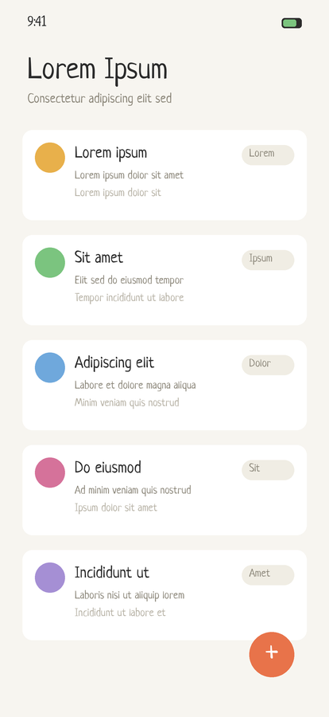
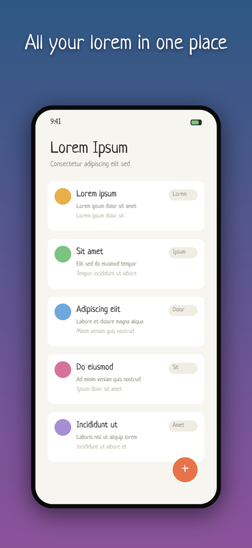

# appshots

Compose App Store marketing screenshots from raw captures, background images,
and localized captions — declaratively, from one `config.json`.

| Raw capture | Composed screenshot |
|:---:|:---:|
|  |  |

One Python file, one dependency (Pillow), one CLI. Change a caption or
swap a screenshot, re-run one command, and every device size and every
language regenerates — no Figma, no per-locale hand editing.

- **Localized captions** — `"caption": {"en": ..., "ru": ...}` renders a full
  per-locale screenshot set, laid out the way `fastlane deliver` uploads it
- **Device presets** — `"iphone-6.9"` instead of memorizing pixel sizes;
  warns when a custom size isn't one App Store Connect accepts
- **Auto-fitting text** — long translations shrink to fit instead of overflowing
- **Glyph safety** — a Latin-only font with a Cyrillic caption fails loudly
  with the missing characters listed, instead of rendering an empty title
- **Composition** — background cover, vignette, device-corner rounding and
  bezel, drop shadows, caption stroke/shadow, pixel-art-safe `nearest` scaling

## Install

```bash
pipx install git+https://github.com/dmitrykhryukin/appshots
# or run straight from a checkout:
pip install Pillow && python appshots.py --config CONFIG.json
```

## Quick start

The repo ships a self-contained example (fake lorem-ipsum app, generated
assets, EN + RU captions):

```bash
appshots --config example/config.json
open example/output/en/iphone-6.9-feed.png
```

## Per-app folder layout

Each app keeps its own config and assets in its own folder (typically inside
the app's repo):

```
my-app-screenshots/
├── config.json
├── fonts/MyFont.ttf
├── backgrounds/
│   ├── feature1.png
│   └── feature2.png
├── input/
│   ├── feature1.png
│   └── feature2.png
└── output/                    # tool writes here
```

```bash
appshots --config /path/to/my-app-screenshots/config.json
```

Render a single screenshot, device, or locale:

```bash
appshots --config CONFIG.json --filter feature1
appshots --config CONFIG.json --device iphone-6.9
appshots --config CONFIG.json --locale ru
```

## Config schema

```json
{
  "devices": ["iphone-6.9", "ipad-13"],
  "output_dir": "./output",
  "missing_background_color": "#1a1a1a",
  "font": {
    "path": "./fonts/MyFont.ttf",
    "size": 140,
    "color": "#FFFFFFFF",
    "shadow": { "color": "#000000AA", "offset": [4, 6], "blur": 0 }
  },
  "layout": {
    "screenshot_scale": 0.78,
    "screenshot_max_height": 0.78,
    "screenshot_offset_y": 0.04,
    "screenshot_shadow": { "color": "#00000080", "offset": [0, 20], "blur": 30 },
    "caption_position_y": 0.10,
    "caption_max_width": 0.92,
    "background_resample": "nearest",
    "screenshot_resample": "nearest"
  },
  "screenshots": [
    {
      "id": "feature1",
      "screenshot": "./input/feature1.png",
      "background": "./backgrounds/feature1.png",
      "caption": "DEFEND YOUR CASTLE!"
    }
  ]
}
```

### Devices

A device is a preset id or a custom `{id, width, height}` dict:

| Preset | Size (portrait) | Add `-landscape` for |
|---|---|---|
| `iphone-6.9` | 1320 × 2868 | 2868 × 1320 |
| `iphone-6.5` | 1284 × 2778 | 2778 × 1284 |
| `ipad-13` | 2064 × 2752 | 2752 × 2064 |

Custom dicts still work (`{ "id": "my-device", "width": 2778, "height": 1284 }`);
a warning is printed when the size isn't one App Store Connect accepts.

### Per-device screenshots

When iPhone and iPad screenshots differ, pass a dict keyed by device id:

```json
{
  "screenshot": {
    "iphone-6.9": "./input/iphone/feature1.png",
    "ipad-13":    "./input/ipad/feature1.png"
  }
}
```

### Localized captions

A caption can be a plain string (same text for every locale) or a dict keyed
by locale:

```json
{
  "caption": {
    "en": "DEFEND YOUR CASTLE!",
    "ru": "ЗАЩИТИ СВОЙ ЗАМОК!",
    "de": "VERTEIDIGE DEINE BURG!"
  }
}
```

As soon as any caption is a dict, output goes to per-locale subfolders —
`output/{locale}/{device.id}-{screenshot.id}.png` — the layout `fastlane
deliver` uploads from. Locales are the union of keys across all captions;
a dict caption missing one of those locales fails that render loudly.
String captions still work per locale (rendered identically into each folder).

Long translations are handled automatically: the font size shrinks until the
caption fits `layout.caption_max_width` (fraction of canvas width, default 0.92).

If the font lacks glyphs for a locale's script (e.g. a Latin-only font with a
Cyrillic caption), the render fails with the list of missing characters instead
of silently drawing an empty title. Fix it with a per-locale font — `font.path`
as a dict with a `default` fallback:

```json
{
  "font": {
    "path": {
      "default": "./fonts/PatrickHand-Regular.ttf",
      "ru":      "./fonts/Neucha-Regular.ttf"
    },
    "size": 140
  }
}
```

### Notes

- All paths in `config.json` are relative to the config file's directory (or absolute).
- Resample defaults to `nearest` — preserves pixel art. Use `lanczos` for smooth photographic backgrounds.
- If a background file is missing, the tool falls back to a solid color so layout work can continue.

## Development

```bash
python tests/smoke.py                    # render the example, verify output
python example/make_fake_screenshot.py   # regenerate the example's fake assets
```

## License

MIT. The bundled example font ([Neucha](https://fonts.google.com/specimen/Neucha))
is licensed under the SIL Open Font License — see `example/fonts/OFL.txt`.
